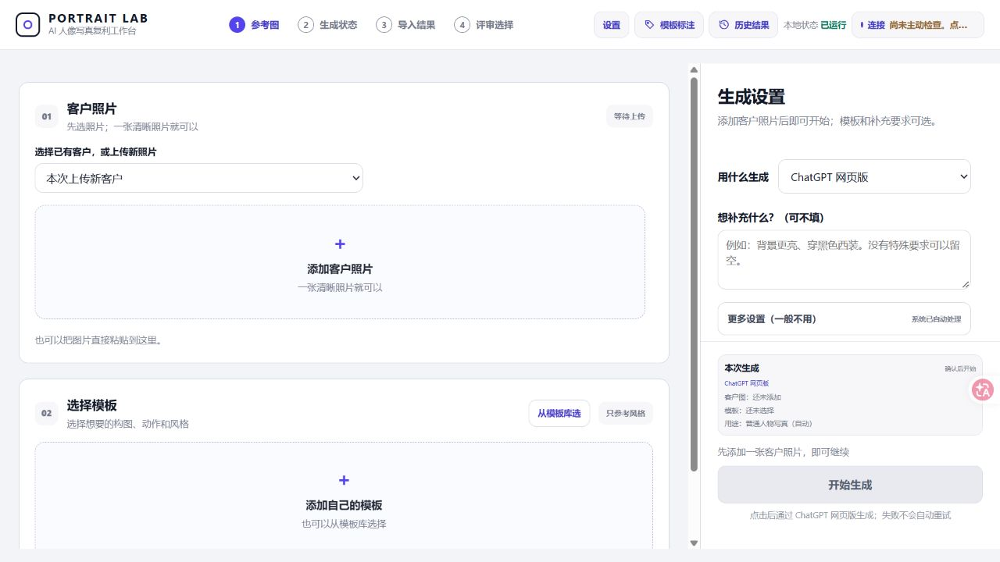
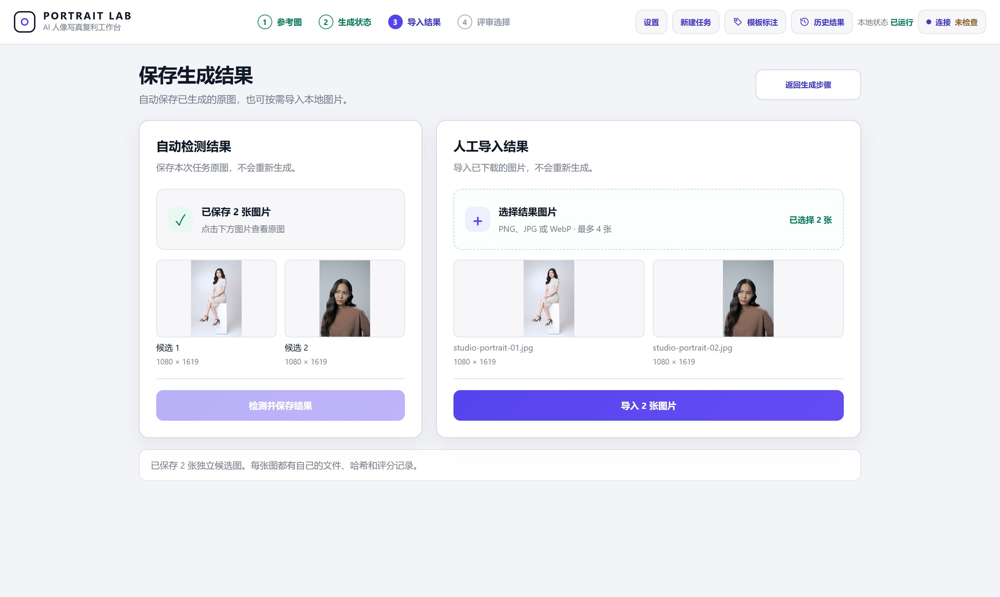

# Portrait Lab

**本地优先的 AI 写真创作与评审工作台。**

从参考图整理、模板选择和生成任务，到图片批注、逐图评分、版本修改与历史复用，放在同一个工作台里完成。






## 产品流程

1. 上传同一人物的参考照片，选择已有模板或添加自己的风格图。
2. 选择 API 或 ChatGPT 网页渠道，检查本次输入后发起生成。
3. 对照参考图查看结果，圈选问题、填写修改要求，保留原图并创建修改版本。
4. 分别评估人脸一致性、自然度与目标风格，再做候选比较和最终选择。

照片、结果、批注和评分保存在本机；发起真实分析或生成时，所选资料会按配置发送到对应服务。本仓库提供程序源码，不附带个人照片、私人模板库、生成结果、账号配置或访问密钥。首次启动是空工作区，可上传自己的素材。

## 实现重点

| 问题 | 对应实现 |
| :-- | :-- |
| 页面重载后不清楚任务是否已经发送 | Run 事件账本与发送前记录；同一任务不自动二次提交，状态不明时进入结果恢复 |
| 后续修改覆盖原任务或原图 | 提交快照、追加事件和父子 Run；批注单独保存，修改版保留来源关系 |
| 历史素材混入其他人物的任务 | 参考图复用校验客户范围、文件哈希与引用角色 |
| 图片编辑只剩下文字描述 | Fabric.js 批注工作区；框选、箭头、文字、撤销重做与局部修改说明 |
| 质量问题和风格偏好混在一起 | 三项评分、质量门槛、A/B 比较与最终选择分开记录 |
| 已淘汰模板又进入下一次推荐 | 模板状态和内容哈希共同参与排除；来源目录与个人选择记录分开 |

## 工程结构

```text
web/
  src/                     本地 HTTP 服务、Run 账本、参考图、生成渠道与评审逻辑
    intelligent-workbench/ 提示词编译、任务解析、推荐与评审投影
  public/                  原生 JavaScript 界面、图片批注与历史工作区
  tests/                   独立数据与模拟接口测试
  fixtures/                非人物测试参数
prompts/                   版本化身份与风格角色约束
knowledge/                 程序读取的评分规则与使用说明
docs/                      架构、验证范围与工作台截图
```

没有把课程模板或运行数据写死到客户端。模板目录、Run 事件、图片和本机配置在运行后进入被 Git 忽略的 `data/`、`.runtime/` 等目录。

## 本地运行

当前公开版本以 **Windows + Node.js 22 或以上** 为支持环境；配置保存使用 Windows ACL。可选的图片观察缩略图处理需要 Python 3 与 Pillow。

```sh
git clone https://github.com/Xinko2438/Portrait-Lab.git
cd Portrait-Lab/web
npm ci
npm start
```

打开 `http://127.0.0.1:4577/`。若端口已被其他实例占用，可在 PowerShell 中先设置 `$env:AI_IMG_GEN_PORT='4599'` 再启动。不要把服务直接开放到公网。

API 渠道在工作台的“设置”里填写自己的服务地址、图片模型与密钥，支持兼容的 `images/generations`、`images/edits` 端点。看图分析的 Responses 配置与图片生成配置分开。真实调用需要自己的服务权限与额度。

ChatGPT 网页渠道还需要 `@playwright/mcp` 扩展连接、已登录的浏览器和本机扩展令牌，依赖外部页面的当前状态。仅安装项目不会获得已登录的账号，也不会自动发起生成。

## 验证

```sh
cd web
npm test
```

本次公开快照在 Windows 上执行 **582 项测试，582 通过**，覆盖账本、幂等与恢复、客户参考图范围、批注、评审、配置保管和模拟 HTTP 流程。依赖私人模板目录或额外浏览器环境的集成用例未放入默认公开测试集。详见 [验证与导出说明](docs/VALIDATION.md)。

这些检查验证程序行为；人物还原、画面质量与模型输出仍需使用者以实际素材评估。项目中的模板表现和提示词实验记录，不代表已经训练出通用审美模型。

## 继续阅读

- [任务、素材与评审的架构](docs/ARCHITECTURE.md)
- [公开快照与验证范围](docs/VALIDATION.md)
- [依赖说明](THIRD_PARTY_NOTICES.md)
