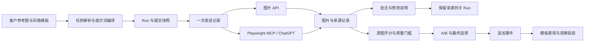

# 任务、素材与评审

Portrait Lab 使用 Node.js 本地 HTTP 服务和原生 JavaScript 界面。业务记录以文件、追加事件和可重建投影组织，图片文件以哈希关联；没有在客户端内嵌服务凭据。

## 数据职责

| 对象 | 后续用途 | 限制 |
| :-- | :-- | :-- |
| 客户参考图和身份集合 | 后续同客户任务选择与复用 | 按客户隔离，不进入跨客户身份参考 |
| Run 提交快照和发送 attempt | 恢复任务并判断是否允许发送 | 查看和恢复不自动重发 |
| Artifact 与来源哈希 | 核对原图、批注和修改版本 | 原图保持独立，不用预览截图代替 |
| 三项评分 | 决定候选是否进入比较 | 人脸失败不当作普通风格失败 |
| A/B 和最终选择 | 记录偏好与交付判断 | 与质量评分分别保存 |
| 模板 outcome 与投影 | 观察模板表现，评估后续策略 | 可从原始事件重建；影子观察不冒充正式策略改善 |

持久化记录本身不等于优化有效。是否改变正式推荐、是否改善后续任务，需要相应的证据量和效果验证。

## 公开版本的独立性

原工作台的配置保存依赖本机工作区的文件保管工具。公开快照将该小型模块随项目收录，使用仓库内的路径包含检查，保留写入前建立私有 Windows ACL、通过标准输入传递凭据和原子替换的流程。原本机工作台没有被此次导出改写。
